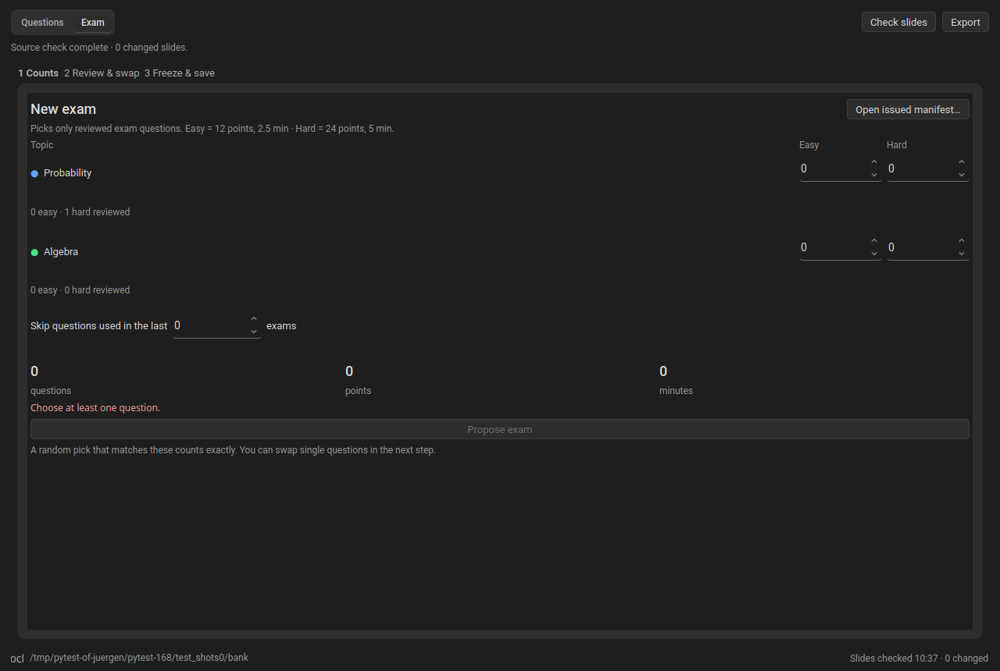

# Exam Forge

SlideMage plugin for writing exam questions for a deck and assembling exams. Open **Exam Forge…** in the Deck menu. Requires SlideMage 0.13.18 or later.

## Questions

<table width="100%">
<tr>
<td width="55%"></td>
<td width="45%" valign="top">

**The bank holds answer keys and rationales: keep its folder private.** Choose the folder on first use; **Change folder…** in Settings moves it.

- Group slides into **topics**; a question's topic is that of its first linked slide.
- Questions are **Multiple choice** or, for exams, **Open answer**, either **Easy** or **Hard**, for a **Revision quiz** or an **Exam**. Each can have images (with descriptions) and a note for teaching assistants. That note appears in the exam: never put answers in it.
- **Answer rules** (Settings) set how many answers and correct answers a question has, per deck.
- Every save creates a draft revision. **Mark reviewed** needs a linked slide.
- Changed slides are flagged. **Review changes** compares old and new text.

**Documented AI use** (off by default, Settings)

- **Draft with AI** writes questions from chosen slides. Answer keys are never sent.
- **Update with AI** drafts a revision of a question whose slide changed.
- Replies arrive as **AI draft** until you review them. A question an AI drafted or revised keeps the permanent **AI-assisted** label.

</td>
</tr>
</table>

## Export

<table width="100%">
<tr>
<td width="55%"></td>
<td width="45%" valign="top">

The **Export** menu holds the answers: keep the files private.

- **Moodle quiz (XML):** reviewed revision-quiz questions. Moodle import is not yet verified.
- **Question table (CSV):** every question, one row each.
- **Question page (HTML):** every question with its answers, like the exam key.

</td>
</tr>
</table>

## Exams

<table width="100%">
<tr>
<td width="55%"></td>
<td width="45%" valign="top">

The **Exam** tab: set easy and hard counts per topic, review and swap the proposal, then **Approve and freeze**. This issues a manifest in the bank folder and saves an exam copy and a private key (HTML). **Record a correction…** logs later changes.

Easy questions are worth 12 points and 2.5 minutes, hard ones 24 points and 5 minutes.

</td>
</tr>
</table>

## Compatibility

Banks from versions before 0.10.0 are upgraded when written, and older versions cannot read them: update every machine that shares a bank.

## Development

Run `QT_QPA_PLATFORM=offscreen python -m pytest -q` with SlideMage's plugin API installed, and `python build.py --check` to validate the package. Keep `CHANGELOG.md` in SlideMage's format; releases are built from version tags.
